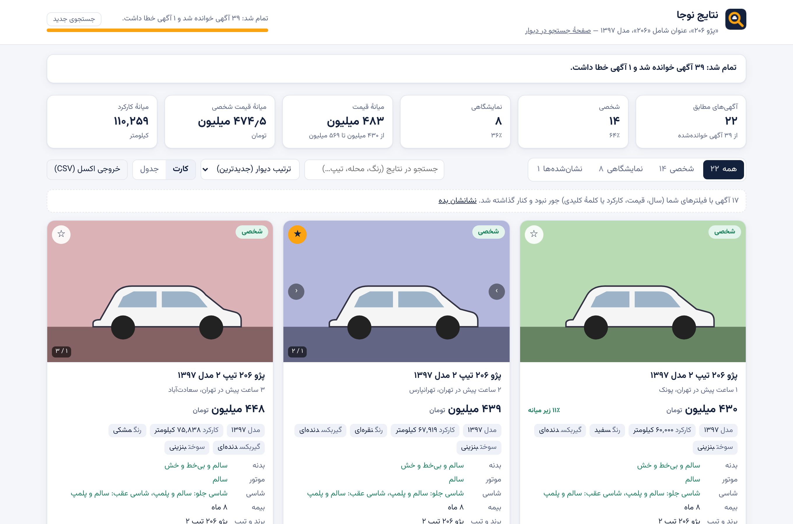
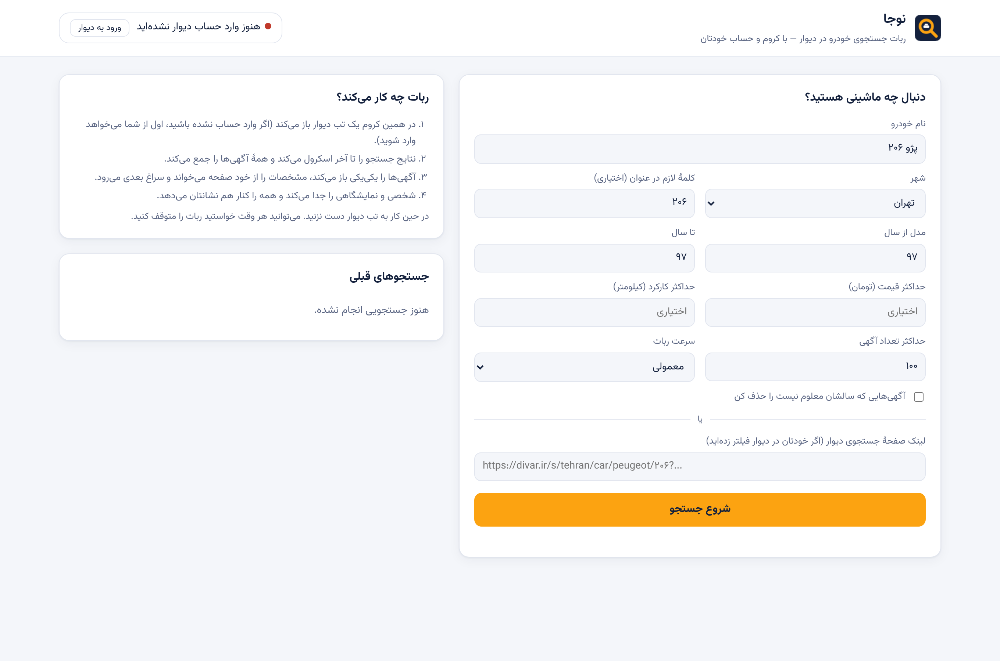
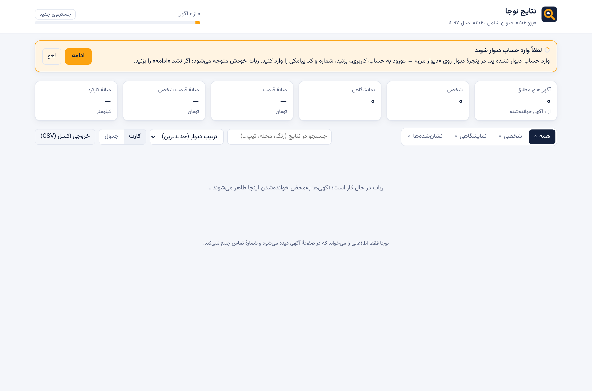

# نوجا — ربات جستجوی خودرو در دیوار

رباتی که **خودش گوگل کروم را باز می‌کند** و با **حساب دیوارِ خودتان** در دیوار می‌گردد:
همهٔ آگهی‌های یک خودروی مشخص (مثلاً **پژو ۲۰۶ مدل ۹۷**) را پیدا می‌کند، آگهی‌ها را یکی‌یکی باز می‌کند،
آگهی‌های **شخصی** را از **نمایشگاهی** جدا می‌کند و مشخصات همه را کنار هم نشان می‌دهد.

ربات مثل یک آدم در کروم می‌گردد و هر چیزی را که لازم دارد از خود صفحه‌ها می‌خواند.
به **API دیوار** هیچ درخواستی نمی‌فرستد.



## روند کار

1. `start.bat` را اجرا می‌کنید ← کروم باز می‌شود و صفحهٔ کنترل نوجا را نشان می‌دهد.
2. ماشین، شهر و سال مدل را می‌نویسید (یا لینک یک جستجوی فیلترشده در دیوار را می‌چسبانید) و «شروع جستجو» را می‌زنید.
3. ربات در همان کروم یک تب دیوار باز می‌کند:
   - اگر وارد حساب نشده باشید، صبر می‌کند تا خودتان وارد شوید (شماره و کد پیامکی). **فقط بار اول لازم است**؛ ورود ذخیره می‌شود.
   - صفحهٔ جستجو را تا آخر اسکرول می‌کند و همهٔ آگهی‌ها را جمع می‌کند.
   - آگهی‌ها را **یکی‌یکی** باز می‌کند، صفحه را کمی اسکرول می‌کند، مشخصات را می‌خواند و سراغ بعدی می‌رود
     (با فاصلهٔ تصادفی چندثانیه‌ای، مثل یک آدم).
   - اگر دیوار کپچا نشان دهد یا بگوید «درخواست زیاد»، ربات صبر می‌کند تا شما در همان پنجره حلش کنید و «ادامه» را بزنید.
4. نتایج **همزمان با کار ربات** در صفحهٔ نتایج ظاهر می‌شوند:
   - تب‌های **همه / شخصی / نمایشگاهی / نشان‌شده‌ها**
   - نمای **کارت** (با گالری عکس) یا **جدول** برای مقایسه
   - قیمت، کارکرد، سال، رنگ، گیربکس، سوخت، وضعیت بدنه/موتور/شاسی، بیمه، معاوضه، توضیحات
   - میانهٔ قیمت، و اینکه هر آگهی چند درصد زیر یا بالای میانه است
   - رنگ قرمز برای ایرادهایی مثل «رنگ‌شدگی»، «تصادفی»، «نیاز به تعمیر»
   - لینک مستقیم به خود آگهی در دیوار
   - خروجی CSV برای اکسل
   - دکمه‌های مکث، ادامه و پایان

### شخصی یا نمایشگاهی؟

1. اگر در صفحهٔ آگهی برچسب یا لینک نمایشگاه/کسب‌وکار باشد ← **نمایشگاهی** (قطعی).
2. اگر در توضیحات کلماتی مثل «نمایشگاه»، «خرید و فروش انواع خودرو»، «ساعات کاری» یا «اقساط» باشد ← **احتمالاً نمایشگاهی**.
3. در غیر این صورت ← **شخصی**.

دلیل هر تشخیص روی کارت (بخش «چرا شخصی/نمایشگاهی؟») نوشته شده تا خودتان قضاوت کنید.

## نصب (یک بار)

1. **Google Chrome** و **Node.js** (نسخهٔ LTS از [nodejs.org](https://nodejs.org)) را نصب کنید.
2. این مخزن را دانلود کنید (Code ← Download ZIP) و از حالت فشرده خارج کنید.
3. **ویندوز:** روی `start.bat` دوبار کلیک کنید.
   **مک/لینوکس:** در ترمینال `./start.sh` را اجرا کنید.

بار اول بسته‌های لازم خودکار نصب می‌شوند (یکی‌دو دقیقه) و بعد کروم باز می‌شود.
برای بستن ربات کافی است پنجرهٔ کروم را ببندید.



### دربارهٔ حساب دیوار و پروفایل کروم

ربات کروم را با یک **پروفایل جداگانه** باز می‌کند (پوشهٔ `chrome-profile` کنار برنامه). بار اول در همین پنجره
وارد حساب دیوار شوید (یا از صفحهٔ کنترل «ورود به دیوار» را بزنید). ورود ذخیره می‌شود و دفعه‌های بعد لازم نیست.

دلیل پروفایل جداگانه: کروم اجازه نمی‌دهد ربات پروفایل اصلی‌ای را که خودتان با آن کار می‌کنید کنترل کند.
پروفایل اصلی هم هنگام باز بودن کروم قفل است. این‌طوری کروم شخصی شما دست‌نخورده می‌ماند.



## نکته‌ها

- **سرعت ربات** را در صفحهٔ کنترل انتخاب کنید. «آهسته» کمترین احتمال حساس‌شدن دیوار را دارد.
  با سرعت «معمولی»، خواندن ۱۵۰ آگهی حدود ۱۰ تا ۱۵ دقیقه طول می‌کشد.
- آگهی‌هایی که در ۶ ساعت گذشته خوانده شده‌اند دوباره باز نمی‌شوند (کش). همین باعث می‌شود جستجوی دوباره سریع باشد.
- در حین کار به تب دیوارِ ربات دست نزنید. بقیهٔ کروم آزاد است.
- **شمارهٔ تماس جمع نمی‌شود.** دیوار برای دیدن شماره محدودیت روزانه دارد و حساب را حساس می‌کند.
  برای تماس، روی «دیدن آگهی در دیوار» بزنید.
- استفاده را شخصی نگه دارید و قوانین دیوار را رعایت کنید.
- اگر دیوار ظاهر صفحه‌هایش را عوض کند، ممکن است بعضی مشخصات خوانده نشوند. ربات چند روش خواندن دارد:
  کلاس‌های صفحه، جدول‌ها، و متن ساده با برچسب‌هایی مثل «کارکرد» و «رنگ».
  اگر چیزی خراب شد، فایل‌های `src/page-scripts.js` و `src/parser.js` جای اصلاح است.
- داده‌ها در پوشهٔ `data` ذخیره می‌شوند و فقط روی کامپیوتر خودتان می‌مانند.
  صفحهٔ کنترل فقط روی `127.0.0.1` در دسترس است.

## ساختار پروژه

```
start.bat / start.sh      اجرای برنامه
src/index.js              نقطهٔ شروع: کروم را باز می‌کند و صفحهٔ کنترل را نشان می‌دهد
src/app.js                راه‌اندازی کروم (پروفایل جدا)، ربات و سرور محلی
src/scanner.js            خودِ ربات: ورود، جستجو، اسکرول، باز کردن آگهی‌ها، کپچا، مکث/توقف
src/page-scripts.js       کدهایی که داخل صفحهٔ دیوار اجرا می‌شوند و محتوای صفحه را می‌خوانند
src/parser.js             تبدیل محتوای صفحه به مشخصات خودرو + تشخیص شخصی/نمایشگاهی
src/server.js             سرور محلی صفحهٔ کنترل و نتایج
src/store.js              ذخیرهٔ جستجوها و کش آگهی‌ها در پوشهٔ data
public/                   صفحهٔ کنترل و صفحهٔ نتایج
tests/                    تست‌ها (پارسر + تست کامل ربات روی یک دیوار شبیه‌سازی‌شده)
```

## تست

```bash
npm test            # تست‌های پارسر
npm run test:e2e    # تست کامل ربات با کرومیوم روی دیوار شبیه‌سازی‌شده (نیاز به playwright)
```
