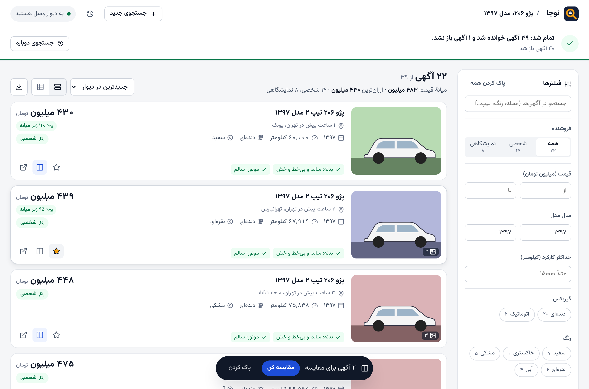
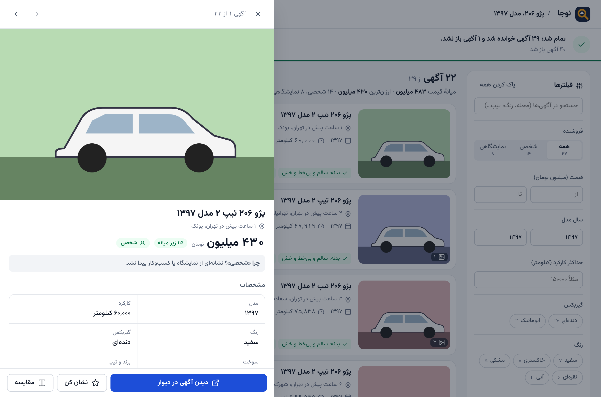
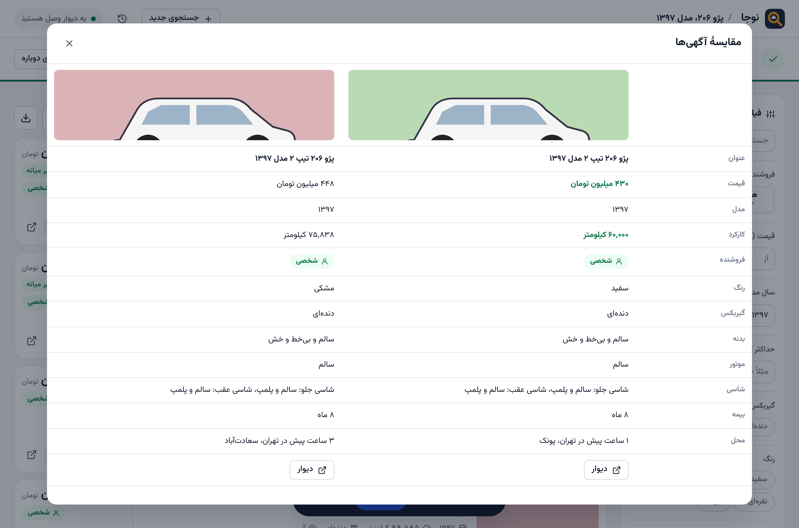
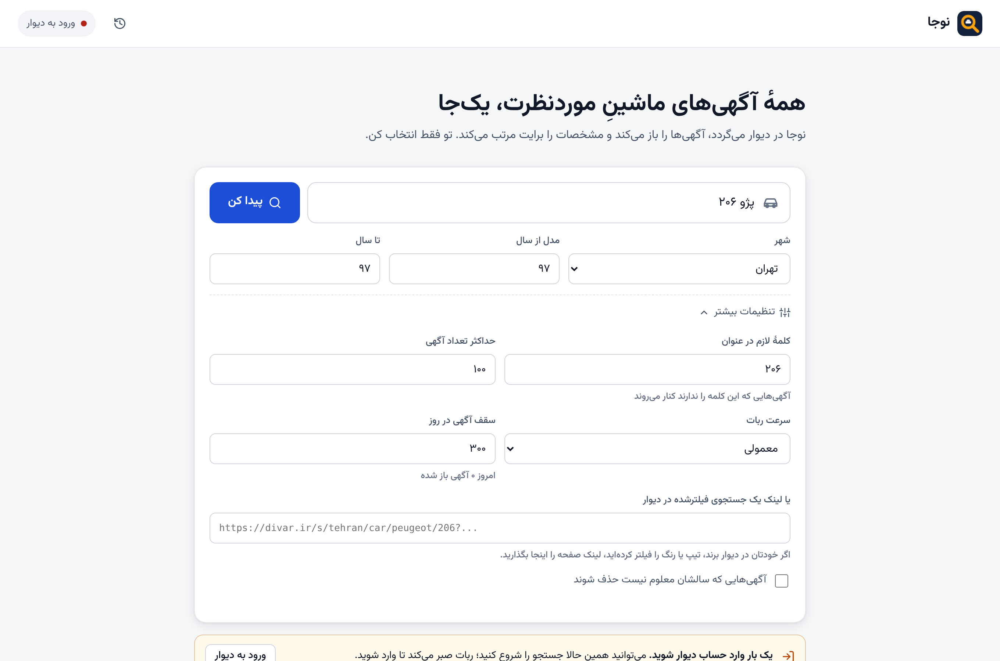

# نوجا — ربات جستجوی خودرو در دیوار

رباتی که **خودش گوگل کروم را باز می‌کند** و با **حساب دیوارِ خودتان** در دیوار می‌گردد:
همهٔ آگهی‌های یک خودروی مشخص (مثلاً **پژو ۲۰۶ مدل ۹۷**) را پیدا می‌کند، آگهی‌ها را یکی‌یکی باز می‌کند،
آگهی‌های **شخصی** را از **نمایشگاهی** جدا می‌کند و مشخصات همه را کنار هم نشان می‌دهد.

ربات مثل یک آدم در کروم می‌گردد و هر چیزی را که لازم دارد از خود صفحه‌ها می‌خواند.
به **API دیوار** هیچ درخواستی نمی‌فرستد.



## روند کار

1. `start.bat` را اجرا می‌کنید ← کروم باز می‌شود و صفحهٔ نوجا را نشان می‌دهد.
2. اسم ماشین، شهر و سال مدل را می‌نویسید و «پیدا کن» را می‌زنید.
3. ربات در همان کروم یک تب دیوار باز می‌کند:
   - اگر وارد حساب نشده باشید، صبر می‌کند تا خودتان وارد شوید (**فقط بار اول**؛ ورود ذخیره می‌شود).
   - مثل یک آدم جستجو می‌کند (جزئیاتش در بخش «رفتار ربات»)، لیست نتایج را مرور می‌کند و آگهی‌ها را یکی‌یکی باز می‌کند.
   - اگر دیوار کپچا نشان دهد، ربات صبر می‌کند تا خودتان حلش کنید.
4. نتایج **همزمان با کار ربات** ظاهر می‌شوند:
   - **فیلترها** در کنار صفحه: شخصی/نمایشگاهی، بازهٔ قیمت و سال، کارکرد، گیربکس، رنگ،
     «فقط بدنهٔ سالم»، «فقط نشان‌شده‌ها» و جستجو در متن آگهی‌ها
   - هر آگهی در یک ردیف جمع‌وجور: عکس، سال، کارکرد، گیربکس، رنگ، وضعیت بدنه و موتور،
     قیمت و درصد اختلاف با میانهٔ قیمت
   - کلیک روی آگهی ← **پنل جزئیات** با گالری عکس، همهٔ مشخصات، توضیحات فروشنده و لینک دیوار
     (با کلیدهای ← و → بین آگهی‌ها جابه‌جا شوید)
   - **مقایسه**: تا ۴ آگهی را کنار هم ببینید؛ بهترین قیمت، کمترین کارکرد و جدیدترین مدل سبز می‌شوند
   - نشان کردن آگهی‌ها، نمای جدولی، خروجی اکسل (CSV)
   - روی موبایل هم درست نمایش داده می‌شود

<p>


</p>

## رفتار ربات

ربات طوری ساخته شده که مثل **یک آدم** در دیوار بگردد و هیچ‌وقت بیشتر از یک بازدیدکنندهٔ عادی به دیوار فشار نیاورد:

- **جستجو را تایپ می‌کند:** اول صفحهٔ خودروهای شهر را باز می‌کند، در کادر جستجو اسم ماشین را با سرعت تایپ آدم می‌نویسد و بعد فیلتر سال را می‌زند.
- **لیست را مرور می‌کند:** با اسکرول‌های نامنظم، گاهی کمی بالا برمی‌گردد و گاهی روی یک آگهی مکث می‌کند.
- **آگهی‌ها را از داخل لیست باز می‌کند:** موس را با یک مسیر منحنی روی آگهی می‌برد و کلیک می‌کند، بعد به لیست برمی‌گردد. حدود یک‌چهارم آگهی‌ها را هم در تب جدید باز و بعد می‌بندد. ترتیب باز کردن هم دقیقاً پشت سر هم نیست.
- **واقعاً «می‌خواند»:** روی هر آگهی چند ثانیه می‌ماند. هرچه متن آگهی بلندتر باشد بیشتر می‌ماند. صفحه را نامنظم پایین و بالا می‌کند و موس را جابه‌جا می‌کند.
- **استراحت می‌کند:** بعد از هر ۱۲ تا ۴۰ آگهی (بسته به سرعت) یک تا چند دقیقه استراحت می‌کند. می‌توانید استراحت را رد کنید.
- **سقف روزانه دارد:** به‌طور پیش‌فرض حداکثر ۳۰۰ آگهی در روز.
- **فقط آگهی‌های جدید را باز می‌کند:** هر آگهی که یک بار خوانده شود برای همیشه در حافظه می‌ماند و دیگر باز نمی‌شود.
  دیوار جدیدترین آگهی‌ها را بالای لیست نشان می‌دهد. برای همین وقتی ربات به ۲۰ آگهی پشت سر هم برسد که قبلاً دیده، اسکرول را تمام می‌کند.
  اگر قیمت یک آگهی قدیمی در لیست عوض شده باشد، فقط همان را دوباره باز می‌کند و تغییر قیمت را نشان می‌دهد
  («۲۵ میلیون ارزان‌تر شد»). آگهی‌های حذف‌شده هم به خاطر سپرده می‌شوند و دوباره امتحان نمی‌شوند.
  در نتایج، آگهی‌های تازه برچسب «جدید» دارند و فیلتر «فقط جدیدها و تغییر قیمت‌ها» هم هست.
- **سه سرعت دارد:** «آهسته» طبیعی‌ترین رفتار را دارد و برای استفادهٔ روزمره توصیه می‌شود.

چیزهایی که ربات **عمداً انجام نمی‌دهد:**
- اثر انگشت مرورگر را جعل نمی‌کند و نشانه‌های اتوماسیون کروم را پنهان نمی‌کند.
- کپچا را حل نمی‌کند. اگر دیوار کپچا نشان دهد، ربات متوقف می‌شود و حلش با شماست.

پس هیچ تضمینی نیست که دیوار هیچ‌وقت متوجه نشود. بهترین محافظت همین سرعت پایین، تعداد کم و سقف روزانه است.


### شخصی یا نمایشگاهی؟

1. اگر در صفحهٔ آگهی برچسب یا لینک نمایشگاه/کسب‌وکار باشد ← **نمایشگاهی** (قطعی).
2. اگر در توضیحات کلماتی مثل «نمایشگاه»، «خرید و فروش انواع خودرو»، «ساعات کاری» یا «اقساط» باشد ← **احتمالاً نمایشگاهی**.
3. در غیر این صورت ← **شخصی**.

دلیل هر تشخیص روی کارت (بخش «چرا شخصی/نمایشگاهی؟») نوشته شده تا خودتان قضاوت کنید.

## نصب (یک بار)

1. **Google Chrome** و **Node.js** (نسخهٔ LTS از [nodejs.org](https://nodejs.org)) را نصب کنید.
2. این مخزن را دانلود کنید (Code ← Download ZIP) و از حالت فشرده خارج کنید.
3. **ویندوز:** روی `start.bat` دوبار کلیک کنید.
   **مک/لینوکس:** در ترمینال `./start.sh` را اجرا کنید.

بار اول بسته‌های لازم خودکار نصب می‌شوند (یکی‌دو دقیقه) و بعد کروم باز می‌شود.
برای بستن ربات کافی است پنجرهٔ کروم را ببندید.



### دربارهٔ حساب دیوار و پروفایل کروم

ربات کروم را با یک **پروفایل جداگانه** باز می‌کند (پوشهٔ `chrome-profile` کنار برنامه). بار اول در همین پنجره
وارد حساب دیوار شوید (یا از صفحهٔ کنترل «ورود به دیوار» را بزنید). ورود ذخیره می‌شود و دفعه‌های بعد لازم نیست.

دلیل پروفایل جداگانه: کروم اجازه نمی‌دهد ربات پروفایل اصلی‌ای را که خودتان با آن کار می‌کنید کنترل کند.
پروفایل اصلی هم هنگام باز بودن کروم قفل است. این‌طوری کروم شخصی شما دست‌نخورده می‌ماند.


## نکته‌ها

- سرعت، سقف روزانه و حداکثر تعداد آگهی در «تنظیمات بیشتر» صفحهٔ اصلی است.
  با سرعت «معمولی» هر آگهی حدود ۱۰ ثانیه طول می‌کشد (با استراحت‌ها، ۱۰۰ آگهی تقریباً ۲۰ تا ۲۵ دقیقه).
- در حین کار به تب دیوارِ ربات دست نزنید. بقیهٔ کروم آزاد است.
- **شمارهٔ تماس جمع نمی‌شود.** دیوار برای دیدن شماره محدودیت روزانه دارد و حساب را حساس می‌کند.
  برای تماس، روی «دیدن آگهی در دیوار» بزنید.
- استفاده را شخصی نگه دارید و قوانین دیوار را رعایت کنید.
- اگر دیوار ظاهر صفحه‌هایش را عوض کند، ممکن است بعضی مشخصات خوانده نشوند. ربات چند روش خواندن دارد:
  کلاس‌های صفحه، جدول‌ها، و متن ساده با برچسب‌هایی مثل «کارکرد» و «رنگ».
  اگر چیزی خراب شد، فایل‌های `src/page-scripts.js` و `src/parser.js` جای اصلاح است.
- داده‌ها در پوشهٔ `data` ذخیره می‌شوند و فقط روی کامپیوتر خودتان می‌مانند.
  صفحهٔ کنترل فقط روی `127.0.0.1` در دسترس است.

## ساختار پروژه

```
start.bat / start.sh      اجرای برنامه
src/index.js              نقطهٔ شروع: کروم را باز می‌کند و صفحهٔ کنترل را نشان می‌دهد
src/app.js                راه‌اندازی کروم (پروفایل جدا)، ربات و سرور محلی
src/scanner.js            خودِ ربات: ورود، جستجو، مرور لیست، باز کردن آگهی‌ها، استراحت، سقف روزانه، کپچا
src/human.js              رفتار انسانی: حرکت منحنی موس، اسکرول نامنظم، تایپ، زمان خواندن
src/page-scripts.js       کدهایی که داخل صفحهٔ دیوار اجرا می‌شوند و محتوای صفحه را می‌خوانند
src/parser.js             تبدیل محتوای صفحه به مشخصات خودرو + تشخیص شخصی/نمایشگاهی
src/server.js             سرور محلی صفحهٔ کنترل و نتایج
src/store.js              ذخیرهٔ جستجوها و کش آگهی‌ها در پوشهٔ data
public/                   رابط کاربری (یک صفحه: جستجو، نتایج، فیلتر، جزئیات، مقایسه)
tests/                    تست‌ها (پارسر + تست کامل ربات روی یک دیوار شبیه‌سازی‌شده)
```

## تست

```bash
npm test            # تست‌های پارسر
npm run test:e2e    # تست کامل ربات با کرومیوم روی دیوار شبیه‌سازی‌شده (نیاز به playwright)
```
