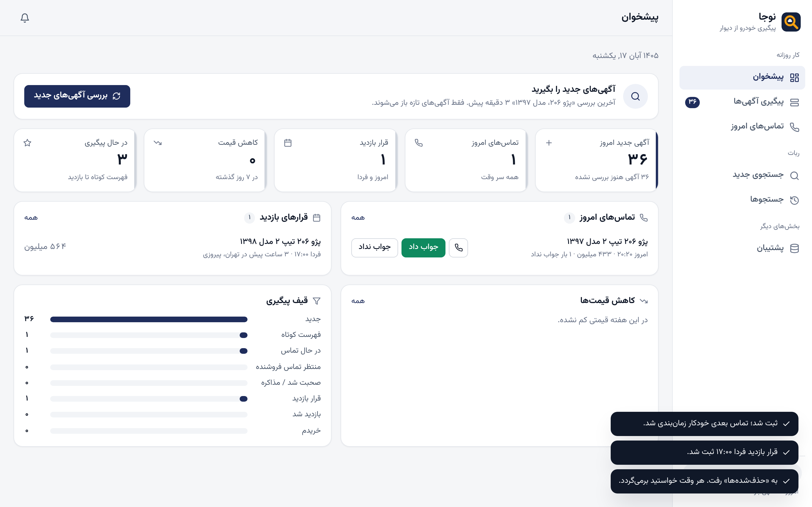
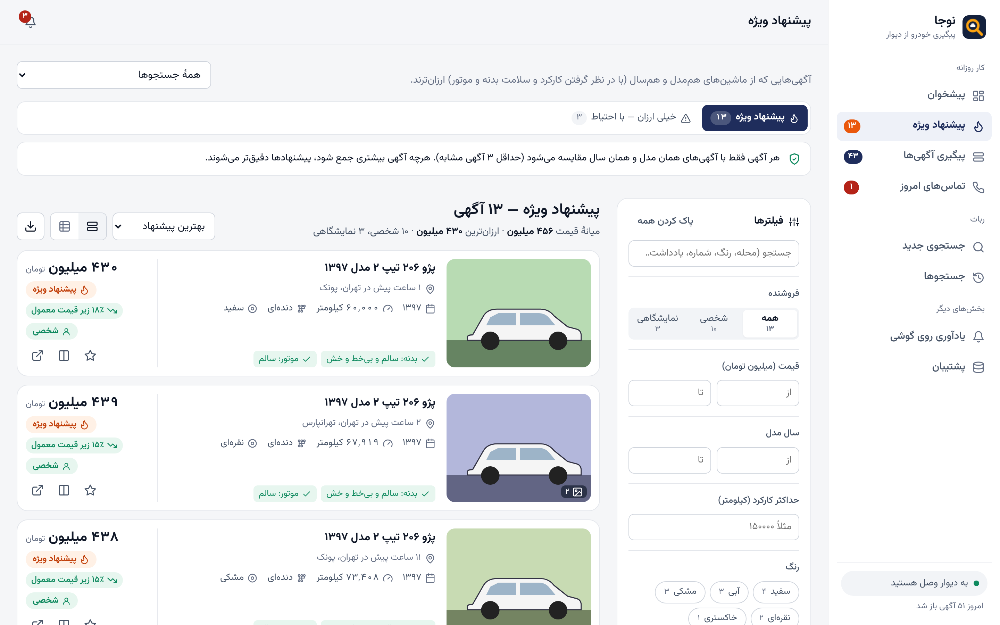
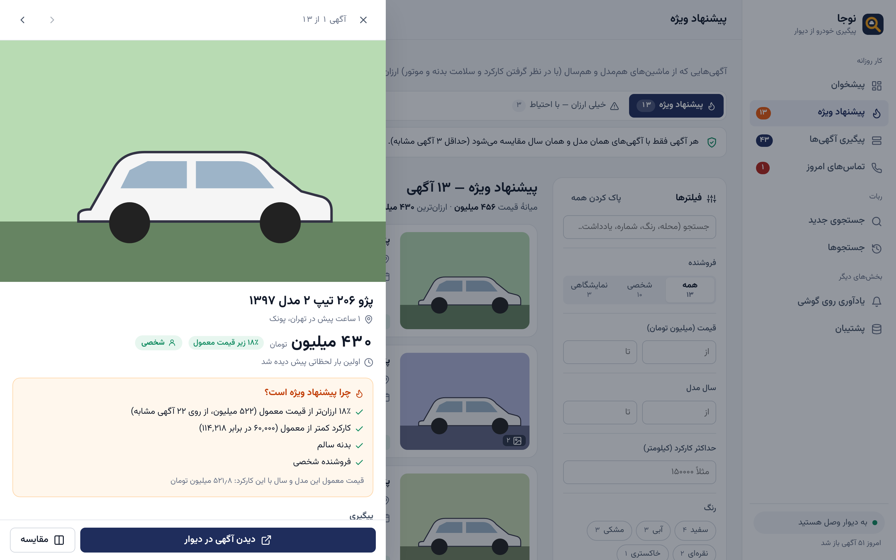
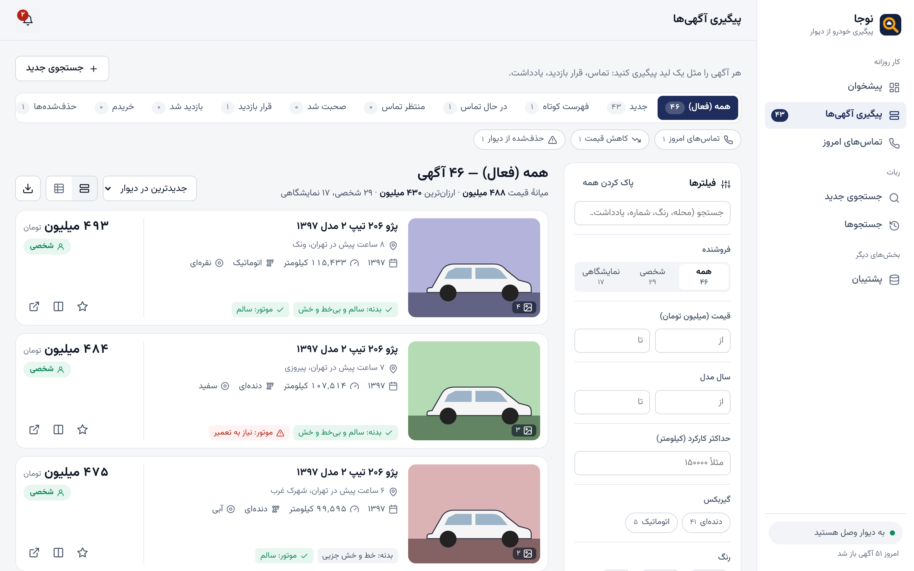
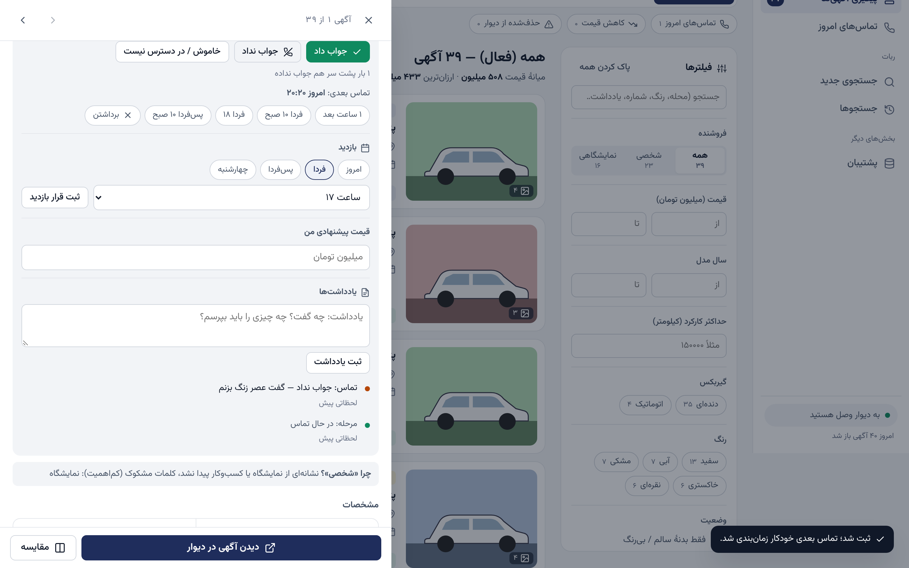
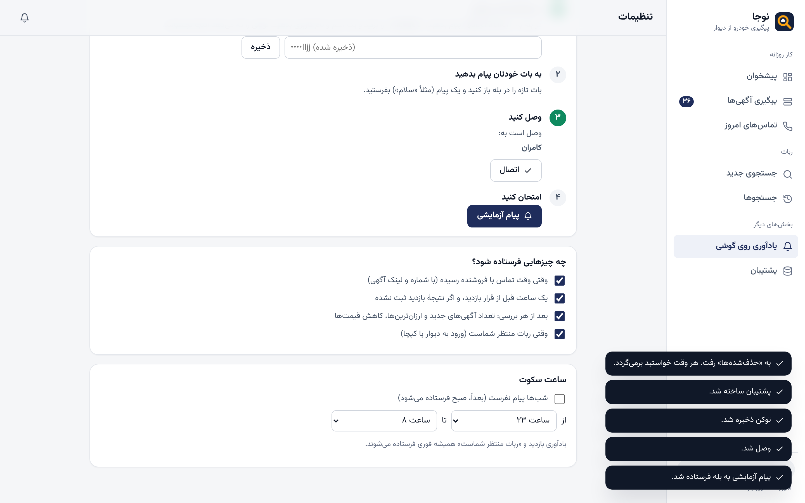
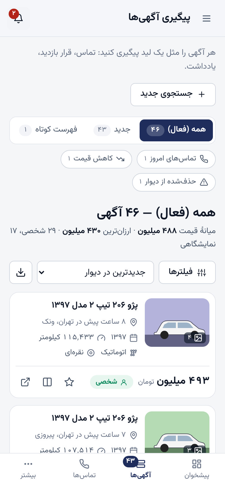
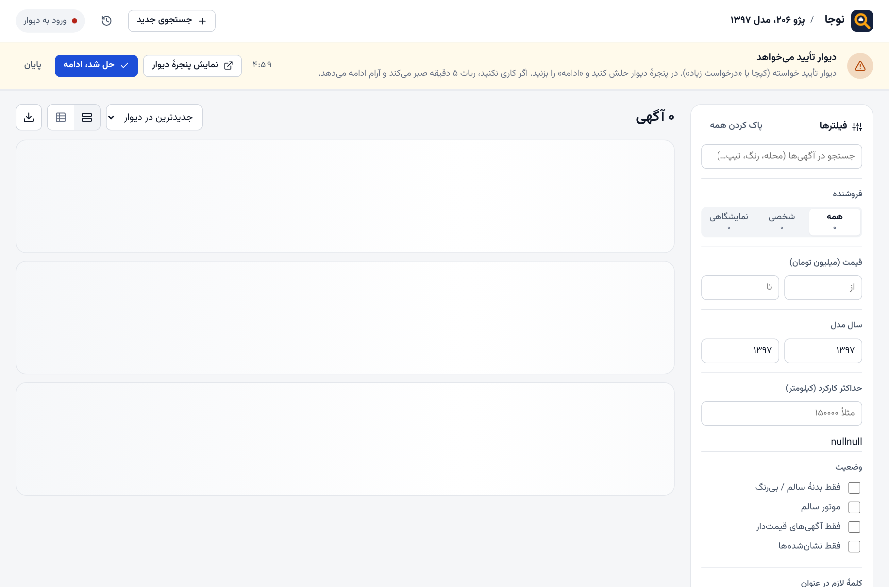
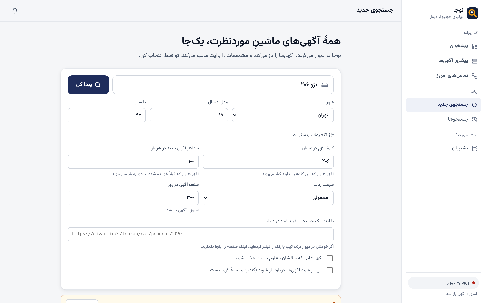

# ردیاب — ربات جستجوی خودرو در دیوار

رباتی که **خودش گوگل کروم را باز می‌کند** و با **حساب دیوارِ خودتان** در دیوار می‌گردد:
همهٔ آگهی‌های یک خودروی مشخص (مثلاً **پژو ۲۰۶ مدل ۹۷**) را پیدا می‌کند، آگهی‌ها را یکی‌یکی باز می‌کند،
آگهی‌های **شخصی** را از **نمایشگاهی** جدا می‌کند و مشخصات همه را کنار هم نشان می‌دهد.

ربات مثل یک آدم در کروم می‌گردد و هر چیزی را که لازم دارد از خود صفحه‌ها می‌خواند.
به **API دیوار** هیچ درخواستی نمی‌فرستد.



## روند کار

1. `start.bat` را اجرا می‌کنید ← کروم باز می‌شود و پیشخوان ردیاب را نشان می‌دهد.
2. در «جستجوی جدید» اسم ماشین، شهر و سال مدل را می‌نویسید و «پیدا کن» را می‌زنید.
3. ربات در همان کروم یک تب دیوار باز می‌کند:
   - اگر وارد حساب نشده باشید، صبر می‌کند تا خودتان وارد شوید. این **فقط بار اول** لازم است و ورود ذخیره می‌شود.
   - مثل یک آدم جستجو می‌کند (بخش «رفتار ربات») و **فقط آگهی‌های جدید** را باز می‌کند.
   - اگر دیوار کپچا نشان دهد، ربات صبر می‌کند تا خودتان حلش کنید.
4. آگهی‌ها به **پیگیری آگهی‌ها** می‌روند. آنجا هر آگهی را مثل یک لید پیگیری می‌کنید (بخش بعد).
5. دفعه‌های بعد در پیشخوان «بررسی آگهی‌های جدید» را بزنید. فقط آگهی‌های تازه، تغییر قیمت‌ها و آگهی‌هایی که در حال پیگیری‌شان هستید بررسی می‌شوند.

## جستجو با مدل یا محدودهٔ قیمت

در «جستجوی جدید» یکی از این سه راه را انتخاب کنید:
- **فقط مدل**، مثلاً «پژو ۲۰۶» با سال ۹۷ تا ۹۷
- **فقط محدودهٔ قیمت**، مثلاً از ۴۰۰ تا ۵۰۰ میلیون تومان (همهٔ خودروهای این بازه)
- **هر دو با هم**

فیلتر قیمت هم روی خود دیوار زده می‌شود، هم دوباره روی نتایج.

## پیشنهاد ویژه

بخش **«پیشنهاد ویژه»** آگهی‌هایی را نشان می‌دهد که از ماشین‌های **هم‌مدل و هم‌سال** ارزان‌ترند:
- قیمت معمول = میانهٔ قیمت آگهی‌های مشابه (حداقل ۳ آگهی)، با در نظر گرفتن کارکرد
- ایرادها امتیاز را کم می‌کنند: رنگ‌شدگی یا تصادف، موتور، شاسی، و کمی هم نمایشگاهی بودن
- آگهی‌ای که بیش از ۳۰٪ ارزان‌تر است، یا قیمتش احتمالاً پیش‌پرداخت یا اقساطی است، جدا در «خیلی ارزان — با احتیاط» می‌آید
- دلیل هر پیشنهاد در کشوی آگهی نوشته شده
- پیشنهادهای ویژهٔ هر بررسی در پیشخوان و پیام گوشی هم می‌آیند

<p>


</p>

## پنل پیگیری (به سبک پیگیری لید نوژا)

**پیشخوان**
- کارت‌های خلاصه: آگهی جدید امروز، تماس‌های امروز، قرار بازدید، کاهش قیمت، در حال پیگیری
- فهرست تماس‌های امروز، با دکمهٔ «جواب داد» و «جواب نداد» برای همان‌جا
- قرارهای بازدید و کاهش قیمت‌ها
- قیف پیگیری، و دلیل‌های حذف

**پیگیری آگهی‌ها**
- برگه‌های مرحله: جدید، فهرست کوتاه، در حال تماس، منتظر تماس، صحبت شد / مذاکره، قرار بازدید، بازدید شد، خریدم، حذف‌شده‌ها
- میان‌برها: «تماس‌های امروز»، «کاهش قیمت»، «حذف‌شده از دیوار»
- فیلترها، مرتب‌سازی، نمای جدولی، مقایسه و خروجی اکسل

**کشوی هر آگهی:**
- مرحلهٔ پیگیری
- شمارهٔ فروشنده با دکمهٔ «زنگ بزن» (شماره را خودتان از دیوار وارد می‌کنید)
- **«جواب نداد»**: دفعات را می‌شمارد و تماس بعدی را خودش زمان‌بندی می‌کند (یک ساعت بعد، بعد سه ساعت بعد، بعد فردا ساعت ۱۰)
- یادآوری تماس با دکمه‌های آماده
- قرار بازدید (روز و ساعت)، و دکمهٔ «بازدید انجام شد»
- قیمت پیشنهادی شما
- یادداشت‌ها و تاریخچهٔ تماس‌ها
- **حذف با دلیل** (گران، تصادفی، نمایشگاهی، فروخته شد…). آگهی حذف‌شده به «حذف‌شده‌ها» می‌رود و برگرداندنی است.

**وضعیت‌های خودکار** (طبق قاعدهٔ نوژا: هرچه از داده معلوم است، خودکار حساب می‌شود):
- آگهی‌ای که در حال پیگیری‌اش هستید، روزی یک بار دوباره بررسی می‌شود. اگر از دیوار حذف شده باشد، «حذف از دیوار (احتمالاً فروخته شد)» می‌خورد.
- کاهش قیمت با تاریخچهٔ قیمت نشان داده می‌شود.
- اگر وقت تماس رسیده باشد، با رنگ قرمز و شمارنده در منو مشخص می‌شود.
- اگر قرار بازدید گذشته باشد و نتیجه‌اش ثبت نشده باشد، «پیگیری فوری» می‌خورد.

همهٔ این‌ها در زنگولهٔ **یادآوری‌ها** هم جمع می‌شوند.

<p>


</p>

**یادآوری روی گوشی** (منو ← «یادآوری روی گوشی»): از سه راه یکی را انتخاب کنید:
- **بله** (پیشنهادی؛ بدون فیلتر و رایگان)
- **تلگرام**
- **پیامک** با همان سرویس sms.ir نوژا

برای بله و تلگرام، این چهار قدم در خود صفحه نوشته شده:
1. با `@BotFather` یک بات بسازید و توکنش را اینجا بگذارید.
2. به بات خودتان «سلام» بدهید.
3. «اتصال» را بزنید.
4. «پیام آزمایشی» را بزنید.

این پیام‌ها فرستاده می‌شوند:
- وقتی وقت تماس رسیده، همراه با شماره و لینک آگهی
- یک ساعت قبل از بازدید
- وقتی نتیجهٔ بازدید ثبت نشده
- بعد از هر بررسی: تعداد آگهی‌های جدید و سه‌تا از ارزان‌ترین‌ها با لینک، و کاهش قیمت‌ها
- «ربات منتظر شماست»، وقتی ورود به دیوار یا کپچا لازم است

ساعت سکوت شبانه دارد (پیام‌ها صبح فرستاده می‌شوند). توکن‌ها فقط روی کامپیوتر خودتان در `data/settings.json` ذخیره می‌شوند.



**پشتیبان:** هر روز خودکار یک نسخه از همهٔ آگهی‌ها، یادداشت‌ها و وضعیت‌ها گرفته می‌شود و ۳۰ روز نگه داشته می‌شود. در صفحهٔ «پشتیبان» این امکانات هست:
- «پشتیبان همین حالا»
- دانلود
- بازگردانی (قبل از بازگردانی، خودکار از وضعیت فعلی پشتیبان گرفته می‌شود)



## رفتار ربات

ربات طوری ساخته شده که مثل **یک آدم** در دیوار بگردد و هیچ‌وقت بیشتر از یک بازدیدکنندهٔ عادی به دیوار فشار نیاورد:

- **جستجو را تایپ می‌کند:** اول صفحهٔ خودروهای شهر را باز می‌کند، در کادر جستجو اسم ماشین را با سرعت تایپ آدم می‌نویسد و بعد فیلتر سال را می‌زند.
- **لیست را مرور می‌کند:** با اسکرول‌های نامنظم، گاهی کمی بالا برمی‌گردد و گاهی روی یک آگهی مکث می‌کند. دیوار هر صفحه را با ۲۴ آگهی نشان می‌دهد؛ ته صفحه، ربات «بعدی» را می‌زند (حداکثر ۱۵ صفحه).
- **آگهی‌ها را از داخل لیست باز می‌کند:** موس را با یک مسیر منحنی روی آگهی می‌برد و کلیک می‌کند، بعد به لیست برمی‌گردد. حدود یک‌چهارم آگهی‌ها را هم در تب جدید باز و بعد می‌بندد. ترتیب باز کردن هم دقیقاً پشت سر هم نیست.
- **واقعاً «می‌خواند»:** روی هر آگهی چند ثانیه می‌ماند. هرچه متن آگهی بلندتر باشد بیشتر می‌ماند. صفحه را نامنظم پایین و بالا می‌کند و موس را جابه‌جا می‌کند.
- **استراحت می‌کند:** بعد از هر ۱۲ تا ۴۰ آگهی (بسته به سرعت) یک تا چند دقیقه استراحت می‌کند. می‌توانید استراحت را رد کنید.
- **سقف روزانه دارد:** به‌طور پیش‌فرض حداکثر ۳۰۰ آگهی در روز.
- **فقط آگهی‌های جدید را باز می‌کند:** هر آگهی که یک بار خوانده شود برای همیشه در حافظه می‌ماند و دیگر باز نمی‌شود.
  دیوار جدیدترین آگهی‌ها را بالای لیست نشان می‌دهد. برای همین وقتی ربات به ۲۰ آگهی پشت سر هم برسد که قبلاً دیده، اسکرول را تمام می‌کند.
  اگر قیمت یک آگهی قدیمی در لیست عوض شده باشد، فقط همان را دوباره باز می‌کند و تغییر قیمت را نشان می‌دهد
  («۲۵ میلیون ارزان‌تر شد»). آگهی‌های حذف‌شده هم به خاطر سپرده می‌شوند و دوباره امتحان نمی‌شوند.
  در نتایج، آگهی‌های تازه برچسب «جدید» دارند و فیلتر «فقط جدیدها و تغییر قیمت‌ها» هم هست.
- **سه سرعت دارد:** «آهسته» طبیعی‌ترین رفتار را دارد و برای استفادهٔ روزمره توصیه می‌شود.

چیزهایی که ربات **عمداً انجام نمی‌دهد:**
- اثر انگشت مرورگر را جعل نمی‌کند و نشانه‌های اتوماسیون کروم را پنهان نمی‌کند.
- کپچا را حل نمی‌کند. اگر دیوار کپچا نشان دهد، ربات متوقف می‌شود و حلش با شماست.

پس هیچ تضمینی نیست که دیوار هیچ‌وقت متوجه نشود. بهترین محافظت همین سرعت پایین، تعداد کم و سقف روزانه است.



### شخصی یا نمایشگاهی؟

1. اگر در صفحهٔ آگهی برچسب یا لینک نمایشگاه/کسب‌وکار باشد ← **نمایشگاهی** (قطعی).
2. اگر در توضیحات کلماتی مثل «نمایشگاه»، «خرید و فروش انواع خودرو»، «ساعات کاری» یا «اقساط» باشد ← **احتمالاً نمایشگاهی**.
3. در غیر این صورت ← **شخصی**.

دلیل هر تشخیص روی کارت (بخش «چرا شخصی/نمایشگاهی؟») نوشته شده تا خودتان قضاوت کنید.

## نصب (یک بار)

1. **Google Chrome** و **Node.js** (نسخهٔ LTS از [nodejs.org](https://nodejs.org)) را نصب کنید.
2. این مخزن را دانلود کنید (Code ← Download ZIP) و از حالت فشرده خارج کنید.
3. **ویندوز:** روی `start.bat` دوبار کلیک کنید.
   **مک/لینوکس:** در ترمینال `./start.sh` را اجرا کنید.

بار اول بسته‌های لازم خودکار نصب می‌شوند (یکی‌دو دقیقه) و بعد کروم باز می‌شود.
برای بستن ربات کافی است پنجرهٔ کروم را ببندید.



### دربارهٔ حساب دیوار و پروفایل کروم

ربات کروم را با یک **پروفایل جداگانه** باز می‌کند (پوشهٔ `chrome-profile` کنار برنامه). بار اول در همین پنجره
وارد حساب دیوار شوید (یا از صفحهٔ کنترل «ورود به دیوار» را بزنید). ورود ذخیره می‌شود و دفعه‌های بعد لازم نیست.

دلیل پروفایل جداگانه: کروم اجازه نمی‌دهد ربات پروفایل اصلی‌ای را که خودتان با آن کار می‌کنید کنترل کند.
پروفایل اصلی هم هنگام باز بودن کروم قفل است. این‌طوری کروم شخصی شما دست‌نخورده می‌ماند.


## پنل آنلاین (کار با گوشی)

پنل روی هاست است و از گوشی یا هر کامپیوتری باز می‌شود. ربات همچنان روی همین کامپیوتر کار می‌کند و
هر ۲۰ ثانیه با پنل همگام می‌شود. حساب دیوار و کروم هیچ‌وقت به هاست نمی‌روند.

- **همیشه کار می‌کند (حتی وقتی کامپیوتر خاموش است):** دیدن آگهی‌ها و پیشنهادهای ویژه، پیگیری
  (تماس، یادداشت، قرار بازدید، حذف)، یادآوری روی گوشی، پشتیبان روزانه.
- **وقتی کامپیوتر روشن است:** جستجوی تازه. اگر کامپیوتر خاموش باشد، جستجو «در صف ربات» می‌ماند و با
  روشن شدن ربات خودش شروع می‌شود. بالای پنل «ربات روشن» یا «ربات خاموش» نوشته می‌شود.
- پیگیری‌ها از هر دو طرف به هم می‌رسند؛ اگر یک آگهی را هم‌زمان در دو جا عوض کنید، تغییرِ تازه‌تر می‌ماند.
- پنل دیتابیس و پوشهٔ جدا دارد و به نرم‌افزار نوژا روی همان هاست دست نمی‌زند.

### نصب روی هاست (یک بار)

1. **ساختن بسته:** روی کامپیوتر `npm run build:host` را بزنید. فایل `dist/radyab-host.zip` ساخته می‌شود.
2. **زیردامنه:** در کنترل‌پنل هاست (cPanel ← Domains) زیردامنهٔ `radyab.nojakasht.com` را بسازید و
   مطمئن شوید SSL (https) برایش فعال است.
3. **دیتابیس:** لازم نیست کاری کنید؛ ردیاب داده‌ها را در پوشهٔ محافظت‌شدهٔ `data` نگه می‌دارد. (اگر دیتابیس MySQL جدا
   بخواهید، در صفحهٔ راه‌اندازی «دیتابیس MySQL جدا» را باز کنید.)
4. **بارگذاری:** در File Manager به پوشهٔ زیردامنه بروید، `radyab-host.zip` را بارگذاری کنید و همان‌جا
   Extract بزنید.
5. **راه‌اندازی:** `https://radyab.nojakasht.com` را باز کنید؛ صفحهٔ «راه‌اندازی ردیاب» می‌آید. نام کاربری و
   رمز پنل را خودتان انتخاب کنید. در پایان **نشانی** و **کلید ربات** نشان
   داده می‌شود. این صفحه فقط یک بار کار می‌کند.
6. **وصل کردن ربات:** در ردیابِ روی کامپیوتر به «یادآوری روی گوشی» ← کارت «پنل آنلاین» بروید، نشانی و
   کلید ربات را بگذارید و «وصل کن» را بزنید. بار اول همهٔ آگهی‌ها و پیگیری‌ها به پنل فرستاده می‌شوند.
7. **یادآوری‌ها وقتی هیچ‌جا باز نیست:** در cPanel ← Cron Jobs یک کار «هر دقیقه» با این فرمان بسازید
   (مسیر پوشه را با مسیر واقعی زیردامنه عوض کنید):
   `php /home/USER/radyab.nojakasht.com/cron.php`
8. **یادآوری روی گوشی** را این بار در خود پنل آنلاین تنظیم کنید (همان صفحه و همان چهار قدم). وقتی ربات به
   پنل وصل است، پیام‌ها فقط از هاست فرستاده می‌شوند.

برای به‌روزرسانی بعدی: بستهٔ تازه را بسازید و روی همان پوشه Extract کنید. `config.php` داخل بسته نیست
و دیتابیس و پشتیبان‌ها دست نمی‌خورند.

## نکته‌ها

- سرعت، سقف روزانه و حداکثر تعداد آگهی در «تنظیمات بیشتر» صفحهٔ اصلی است.
  با سرعت «معمولی» هر آگهی حدود ۱۰ ثانیه طول می‌کشد (با استراحت‌ها، ۱۰۰ آگهی تقریباً ۲۰ تا ۲۵ دقیقه).
- در حین کار به تب دیوارِ ربات دست نزنید. بقیهٔ کروم آزاد است.
- **شمارهٔ تماس جمع نمی‌شود.** دیوار برای دیدن شماره محدودیت روزانه دارد و حساب را حساس می‌کند.
  برای تماس، روی «دیدن آگهی در دیوار» بزنید.
- استفاده را شخصی نگه دارید و قوانین دیوار را رعایت کنید.
- اگر دیوار ظاهر صفحه‌هایش را عوض کند، ممکن است بعضی مشخصات خوانده نشوند. ربات چند روش خواندن دارد:
  کلاس‌های صفحه، جدول‌ها، و متن ساده با برچسب‌هایی مثل «کارکرد» و «رنگ».
  اگر چیزی خراب شد، فایل‌های `src/page-scripts.js` و `src/parser.js` جای اصلاح است.
- داده‌ها در پوشهٔ `data` ذخیره می‌شوند و فقط روی کامپیوتر خودتان می‌مانند.
  صفحهٔ کنترل فقط روی `127.0.0.1` در دسترس است.

## ساختار پروژه

```
start.bat / start.sh      اجرای برنامه
src/index.js              نقطهٔ شروع: کروم را باز می‌کند و صفحهٔ کنترل را نشان می‌دهد
src/app.js                راه‌اندازی کروم (پروفایل جدا)، ربات و سرور محلی
src/scanner.js            خودِ ربات: ورود، جستجو، مرور لیست، فقط آگهی‌های جدید، بررسی روزانهٔ آگهی‌های در پیگیری، کپچا
src/deals.js              پیشنهاد ویژه: مقایسه با آگهی‌های هم‌مدل و هم‌سال (در مرورگر و سرور)
src/notify.js             یادآوری روی گوشی: بله، تلگرام، پیامک (sms.ir)، ساعت سکوت
src/crm.js                قواعد پیگیری: مرحله‌ها، «جواب نداد» و زمان‌بندی تماس بعدی، حذف با دلیل، قرار بازدید
src/human.js              رفتار انسانی: حرکت منحنی موس، اسکرول نامنظم، تایپ، زمان خواندن
src/page-scripts.js       کدهایی که داخل صفحهٔ دیوار اجرا می‌شوند و محتوای صفحه را می‌خوانند
src/parser.js             تبدیل محتوای صفحه به مشخصات خودرو + تشخیص شخصی/نمایشگاهی
src/server.js             سرور محلی صفحهٔ کنترل و نتایج
src/store.js              حافظهٔ دائمی آگهی‌ها و پیگیری‌ها، جستجوها، پشتیبان روزانه (پوشهٔ data)
src/cloud.js              اتصال به پنل آنلاین: همگام‌سازی هر ۲۰ ثانیه، صف جستجوهای گوشی
host/                     پنل آنلاین روی هاست (PHP + MySQL): api.php، setup.php، cron.php، lib/
tools/build-host.js       ساختن بستهٔ هاست (dist/radyab-host.zip)
public/                   رابط کاربری: core (داده و ابزار)، browser (فهرست، فیلتر، کشو، مقایسه)،
                          pages (پیشخوان، پیگیری، جستجو، پشتیبان)، app (منو و مسیریابی)
tests/                    تست‌ها (پارسر + تست کامل ربات روی یک دیوار شبیه‌سازی‌شده)
```

## تست

```bash
npm test            # تست‌های پارسر + خواندن صفحه‌های ذخیره‌شده از دیوار واقعی (tests/fixtures/divar-*.html)
npm run test:e2e    # تست کامل ربات با کرومیوم روی دیوار شبیه‌سازی‌شده (نیاز به playwright)
npm run test:host   # تست کامل پنل آنلاین با PHP و SQLite: راه‌اندازی، ورود، همگام‌سازی، صف، پشتیبان (نیاز به PHP)
```
