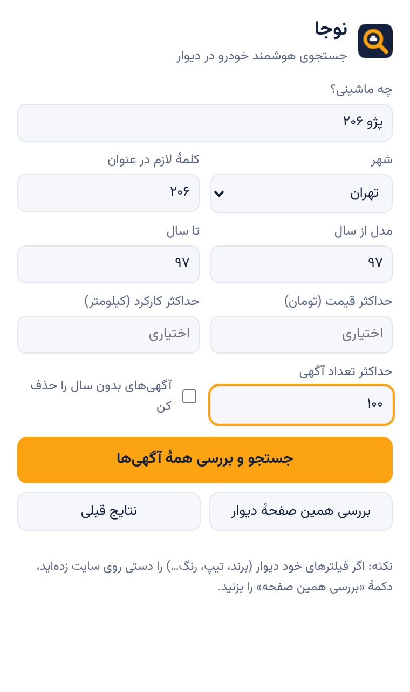

# نوجا — جستجوگر هوشمند خودرو در دیوار

افزونهٔ کروم که همهٔ آگهی‌های یک خودروی مشخص (مثلاً **پژو ۲۰۶ مدل ۹۷**) را در دیوار پیدا می‌کند،
آگهی‌های **شخصی** را از **نمایشگاهی** جدا می‌کند و مشخصات همه را کنار هم نشان می‌دهد.


## چه کار می‌کند؟

1. شما ماشین، شهر و سال مدل را می‌گویید.
2. نوجا صفحهٔ جستجوی دیوار را باز می‌کند و خودش تا ته لیست اسکرول می‌کند تا همهٔ آگهی‌ها را جمع کند.
3. جزئیات تک‌تک آگهی‌ها را (آهسته و با فاصله، تا به دیوار فشار نیاید) می‌خواند:
   قیمت، کارکرد، سال، رنگ، گیربکس، سوخت، وضعیت بدنه/موتور/شاسی، بیمه، معاوضه، توضیحات و عکس‌ها.
4. آگهی‌ها را با فیلترهای شما (سال، کلمهٔ لازم در عنوان، حداکثر قیمت و کارکرد) غربال می‌کند.
5. نتیجه را در یک صفحه نشان می‌دهد:
   - تب‌های **همه / شخصی / نمایشگاهی / نشان‌شده‌ها**
   - نمای **کارت** (با گالری عکس) یا **جدول** برای مقایسهٔ سریع
   - مرتب‌سازی بر اساس قیمت، کارکرد و سال
   - میانهٔ قیمت و اینکه هر آگهی چند درصد زیر/بالای میانه است
   - رنگ قرمز برای ایرادهایی مثل «رنگ‌شدگی»، «تصادفی»، «نیاز به تعمیر»
   - لینک مستقیم به خود آگهی در دیوار
   - خروجی CSV برای اکسل

### شخصی یا نمایشگاهی؟

ترتیب تشخیص:
1. **نشانهٔ خود دیوار** (نوع آگهی‌دهنده / اتصال آگهی به کسب‌وکار / برچسب «نمایشگاه …») ← قطعی.
2. **کلمات توضیحات** مثل «نمایشگاه»، «خرید و فروش انواع خودرو»، «ساعات کاری»، «اقساط» ← «احتمالاً نمایشگاهی».
3. در غیر این صورت ← شخصی.

دلیل هر تشخیص روی کارت (بخش «چرا شخصی/نمایشگاهی؟») نوشته شده تا خودتان قضاوت کنید.

## نصب (حدود ۱ دقیقه)

1. این مخزن را دانلود کنید (Code ← Download ZIP) و از حالت فشرده خارج کنید.
2. در کروم (یا Edge/Brave) به آدرس `chrome://extensions` بروید.
3. **Developer mode** را (بالا سمت راست) روشن کنید.
4. **Load unpacked** را بزنید و پوشهٔ `extension` را انتخاب کنید.
5. آیکون نوجا را از منوی افزونه‌ها (🧩) پین کنید.

## استفاده

**روش ۱ — از خود افزونه:** روی آیکون نوجا بزنید، مثلاً بنویسید «پژو ۲۰۶»، کلمهٔ لازم «206»، سال از ۹۷ تا ۹۷،
و «جستجو و بررسی همهٔ آگهی‌ها» را بزنید. یک تب دیوار باز می‌شود، خودش اسکرول می‌کند و بعد صفحهٔ نتایج باز می‌شود.

**روش ۲ — با فیلترهای خود دیوار (دقیق‌تر):** در سایت دیوار خودتان برند/تیپ/سال/رنگ را فیلتر کنید،
بعد روی آیکون نوجا بزنید و «بررسی همین صفحهٔ دیوار» را انتخاب کنید.

هر وقت خواستید وسط کار دکمهٔ «کافیه، نتایج را نشان بده» را بزنید تا با همان تعداد آگهی ادامه دهد.
نتایج ۶ ساعت کش می‌شوند و «نتایج قبلی» بدون درخواست دوباره باز می‌شود.



## نکته‌ها و محدودیت‌ها

- افزونه داخل مرورگر خودتان کار می‌کند، پس همان دسترسی‌ای را دارد که خودتان به دیوار دارید (سرور جداگانه لازم نیست).
- فقط اطلاعات عمومی آگهی‌ها خوانده می‌شود؛ **شمارهٔ تماس جمع‌آوری نمی‌شود**. برای تماس، روی «دیدن آگهی در دیوار» بزنید.
- برای احترام به دیوار، درخواست‌ها با سرعت کم (۲ تا هم‌زمان با چند صد میلی‌ثانیه فاصله) ارسال می‌شوند و اگر دیوار
  بگوید «آهسته‌تر» (خطای ۴۲۹)، صبر می‌کند. استفاده را شخصی نگه دارید و قوانین دیوار را رعایت کنید.
- دیوار گاهی ساختار سایتش را عوض می‌کند. پارسر طوری نوشته شده که به ساختار دقیق وابسته نباشد
  (هر ردیف «عنوان/مقدار» را برمی‌دارد) و اگر API جواب ندهد، خود صفحهٔ آگهی را می‌خواند؛
  با این حال اگر چیزی خراب شد، فایل `extension/src/parser.js` جای اصلاح است.
- تشخیص «احتمالاً نمایشگاهی» از روی متن است و ممکن است گاهی اشتباه کند.

## ساختار پروژه

```
extension/
  manifest.json          تنظیمات افزونه (Manifest V3)
  src/parser.js          استخراج مشخصات و تشخیص شخصی/نمایشگاهی (بدون وابستگی، قابل تست در Node)
  src/content.js         روی divar.ir اجرا می‌شود؛ اسکرول و جمع‌آوری لینک آگهی‌ها
  src/background.js      ذخیرهٔ نتایج جمع‌آوری و باز کردن صفحهٔ نتایج
  popup/                 پنجرهٔ کوچک افزونه (فرم جستجو)
  results/               صفحهٔ نتایج (کارت، جدول، آمار، CSV)
  fonts/                 فونت وزیرمتن (OFL)
tests/
  parser.test.js         تست‌های واحد پارسر
  e2e.js                 تست کامل با کرومیوم و یک دیوار شبیه‌سازی‌شده
```

## تست

```bash
npm test            # تست‌های پارسر
npm run test:e2e    # تست کامل (نیاز به playwright و chromium)
```
